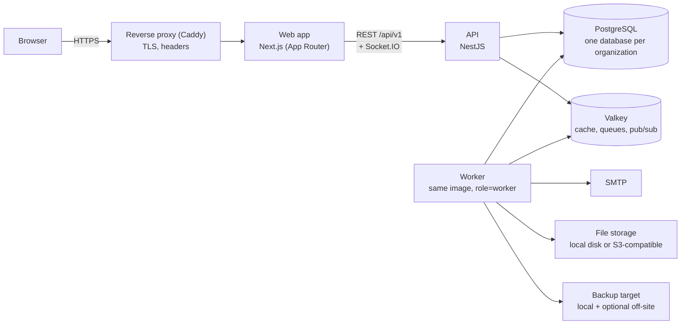

# New application architecture: the "Inspower Core" platform

|              |                                                                                                                                                                                                                                                                                                                                                     |
| ------------ | --------------------------------------------------------------------------------------------------------------------------------------------------------------------------------------------------------------------------------------------------------------------------------------------------------------------------------------------------- |
| **Status**   | Draft for review (no code written yet)                                                                                                                                                                                                                                                                                                              |
| **Written**  | 1 November 2026                                                                                                                                                                                                                                                                                                                                     |
| **Revised**  | 1 November 2026: owner decisions applied. Minimum password length is **8**. The app must work on **phones and tablets** as well as desktops. A fixed **Super Admin** role holds every permission and cannot be edited (§8.5). Recommendations added in §17.                                                                                         |
| **Revised**  | 1 November 2026 (second round): two-factor is **recommended with reminders, not enforced**. The new application is built **from scratch in a new repository**; nothing is copied from this one, the current app is used only as a reference for behaviour.                                                                                          |
| **Based on** | A full read of the current `appname` / Inspower repository (`apps/api`, `apps/web`, `apps/connector`, `packages/*`, `infra/*`, `scripts/*`, README, deployment plan)                                                                                                                                                                                |
| **Goal**     | Design a new, smaller application that has only the **foundation**: landing page, sign-in, users and permissions, two-factor authentication, password rules, backup and restore, theme and appearance, settings. No Dentally, Xero, CareStack, Tally or any other outside system is connected. Business modules come later and plug into this core. |

---

## Contents

1. [What the current application is](#1-what-the-current-application-is)
2. [What to keep, what to leave behind](#2-what-to-keep-what-to-leave-behind)
3. [Scope of the new application](#3-scope-of-the-new-application)
4. [Architecture at a glance](#4-architecture-at-a-glance)
5. [Technology choices](#5-technology-choices)
6. [Repository layout](#6-repository-layout)
7. [Database design](#7-database-design)
8. [Module by module design](#8-module-by-module-design)
   - 8.1 Landing page and public site
   - 8.2 Sign-in and sessions
   - 8.3 Two-factor authentication
   - 8.4 Password rules
   - 8.5 Users, roles and permissions
   - 8.6 Organization and settings
   - 8.7 Theme and appearance
   - 8.8 Backup and restore
   - 8.9 Audit log and notifications
   - 8.10 Background jobs and health
9. [Security design](#9-security-design)
10. [API design](#10-api-design)
11. [Web app design](#11-web-app-design)
12. [Testing strategy](#12-testing-strategy)
13. [Deployment and operations](#13-deployment-and-operations)
14. [Delivery plan: phases and milestones](#14-delivery-plan-phases-and-milestones)
15. [Decisions to confirm before coding](#15-decisions-to-confirm-before-coding)
16. [Risks](#16-risks)
17. [Recommendations](#17-recommendations)

---

## 1. What the current application is

The current repository is a **dental-practice management and finance platform** that grew one request at a time. It is large:

| Measure                                 | Current app                                             |
| --------------------------------------- | ------------------------------------------------------- |
| Source files (excluding `node_modules`) | about 1,700                                             |
| Prisma models                           | 259 in a 6,600-line schema                              |
| Database migrations                     | 140                                                     |
| NestJS feature modules                  | about 45, side by side under `apps/api/src`             |
| Permission keys                         | about 144 core keys, plus a separate Associate Pay tree |
| Feature switches                        | 33                                                      |
| Sidebar config                          | one 1,500-line hand-written file                        |
| README                                  | 260 KB, used as the project's memory                    |

**Stack today:** pnpm + turbo monorepo on Node 24; Next.js 16 (App Router, React 19) web app; NestJS 12 on Express 5 API with a separate background worker; Prisma 7 on PostgreSQL 17; Valkey (Redis) for cache, queues (BullMQ) and realtime (Socket.IO); shadcn/ui + Tailwind 4 design system; Zod 4 schemas shared between web and API; vitest, Playwright, oxlint/ESLint, Prettier.

**Where the foundation already lives** (used as a **reference for behaviour only**; no code is copied into the new repository):

- `apps/api/src/auth/` — sign-in, sessions, TOTP two-factor, recovery codes, trusted devices, step-up, password reset, invitations.
- `apps/api/src/access/` + `packages/shared/src/permissions.ts` — permission registry, role sync, deny-by-default guard.
- `apps/api/src/admin/` — users, roles, audit log, system status.
- `apps/api/src/settings/` + `packages/shared/src/settings.ts` — General, Appearance, Localization, Security, Email, Notifications, Maintenance.
- `packages/shared/src/theme.ts` + `packages/ui/src/styles/globals.css` — brand-colour theme engine with WCAG checks.
- `apps/api/src/backup/`, `scripts/backup.ps1`, `scripts/restore-backup.ps1`, `infra/vps/bin/inspower` — encrypted database backups.
- `apps/api/src/jobs/`, `scheduler/`, `realtime/`, `health/` — worker, scheduled jobs, live updates, health checks.
- `apps/web/src/app/(auth)`, `(public)`, `(app)/admin`, `(app)/profile` — the matching screens.

Everything else (finance, associate pay, contracts, tasks, daily reports, NHS, Invisalign, reports, HTML import, Tally connector, Dentally/Xero/CareStack integrations, legacy, special projects, website discovery) is **business functionality** and is out of scope for the new core.

## 2. What to keep, what to leave behind

### Keep (proven, well designed)

| Area                        | What is good about it                                                                                                                                  |
| --------------------------- | ------------------------------------------------------------------------------------------------------------------------------------------------------ |
| Opaque server-side sessions | Token stored only as a SHA-256 hash, idle + absolute timeouts, Redis cache with fast revocation, "sign out other sessions"                             |
| Cookie and CSRF design      | `__Host-` cookies, HttpOnly, SameSite=Lax, double-submit CSRF token plus Origin check                                                                  |
| Passwords                   | Argon2id with automatic rehash, zxcvbn strength scoring shared by client and server, password history, dummy hash for unknown emails                   |
| Two-factor                  | TOTP with replay protection, AES-256-GCM encrypted secret with key fingerprint, HMAC-hashed recovery codes, trusted devices, step-up re-authentication |
| Brute-force protection      | Per-email progressive delay, lockout with email, per-IP block, reset-request limits                                                                    |
| Tokens                      | Every token (session, reset, invitation, email change, device) is single-use, hashed, expiring                                                         |
| Authorization               | Deny-by-default guard, startup check that every route has a rule, typed permission registry in code synced to the database                             |
| Audit log                   | Written in the same transaction as the change, append-only enforced by a Postgres trigger, pushed live to admin screens                                |
| Settings model              | Zod-typed sections, each saved independently, step-up for sensitive sections                                                                           |
| Theme engine                | One brand colour generates all tokens for light and dark, contrast checked by tests, logo/favicon/sign-in image per site                               |
| Feature switches            | off / on / super-admin-only / selected-users with dependencies, 404 on both API and web                                                                |
| Worker & scheduler          | Separate process, declarative job registry, catch-up runs, pause/resume/run-now, Bull Board                                                            |
| Realtime                    | Transactional outbox, Redis adapter, replay window                                                                                                     |
| Packaging                   | One Docker image with role entrypoints (api / worker / web / migrate), one database per client                                                         |

### Leave behind or redo

| Problem today                                                                                 | Decision for the new app                                                                                                                                                                             |
| --------------------------------------------------------------------------------------------- | ---------------------------------------------------------------------------------------------------------------------------------------------------------------------------------------------------- |
| `auth.service.ts` is one 1,100-line class                                                     | Split into credentials, sessions, mfa, recovery, invitations modules                                                                                                                                 |
| 2FA enforcement is unclear (comment says required, code never forces setup)                   | Make it an explicit policy setting: _required for everyone / required for admins / optional_                                                                                                         |
| Rate limits fail open when Redis is down                                                      | Decide fail-closed for sign-in and keep the database lock as a backstop                                                                                                                              |
| Lockout state split between Redis and `users.lockedUntil`                                     | Database is the single source of truth; Redis only holds the short-lived counters                                                                                                                    |
| Per-user preferences are columns on `users`                                                   | Separate `user_preferences` table                                                                                                                                                                    |
| Global settings are untyped JSON key/value rows                                               | Keep key/value storage but add a version column and a Zod schema per section, with migrations for shape changes                                                                                      |
| Single-tenant `Company` singleton with no `tenant_id`                                         | Keep **one organization per deployment** (database per client, as today) but add an `organization_id` column on every table from day one so a future shared-database SaaS does not require a rewrite |
| One role per user in practice                                                                 | Multiple roles per user, with an optional location scope on each assignment                                                                                                                          |
| 144+ page-level permission keys and dated migration maps in code                              | Coarser `resource.action` permissions (target 25 to 40 keys for the core), with a single versioned migration list                                                                                    |
| Four separate access systems (roles, Associate Pay tree, My Action Point JSON, feature parts) | One permission model; features are switches, not access rules                                                                                                                                        |
| Hand-written 1,500-line nav config                                                            | Nav generated from route metadata that also drives the page guard                                                                                                                                    |
| Windows/PowerShell/WSL-only scripts with hard-coded paths                                     | Cross-platform Node/TypeScript CLI (`pnpm inspower <command>`) and Docker for everything                                                                                                             |
| Backup plan and code disagree (age + B2 vs AES-CBC + OneDrive)                                | One documented design: AES-256-GCM (authenticated), local + optional off-site target, GFS retention, in-app backup screen, scheduled restore test                                                    |
| Uploads stored as `Bytes` in Postgres                                                         | Small brand assets may stay in the database; a file-storage abstraction (local disk now, S3-compatible later) for everything else                                                                    |
| CI runs no integration or e2e tests                                                           | CI runs unit, integration (Postgres + Valkey service containers) and e2e, and builds the image                                                                                                       |
| Placeholder `appname` / `@appname/*` naming baked into cookies and packages                   | Name the product once in a config file; package scope `@inspower/*`                                                                                                                                  |
| 260 KB README                                                                                 | Short README; `docs/` folder with ADRs, runbooks and this plan                                                                                                                                       |
| Report-only CSP                                                                               | Enforced CSP with nonces from the start, while the app is small                                                                                                                                      |

## 3. Scope of the new application

### In scope (version 1.0 of the core)

1. **Landing page** – public marketing page with product name, description, sign-in link, privacy page, and a contact form that only sends an email.
2. **Sign-in** – email + password, remember me, forgot/reset password, session timeout warning, session list and remote sign-out.
3. **Two-factor authentication** – TOTP (authenticator app), recovery codes, trusted devices, policy-based enforcement, step-up for sensitive actions.
4. **Password rules** – configurable minimum length, strength score, history, breached-password check, forced change, expiry (optional).
5. **Users** – invite, accept invitation, profile, preferences, deactivate/reactivate, anonymise (GDPR delete), admin reset of 2FA.
6. **Roles and permissions** – built-in roles (Owner, Administrator, Member, Viewer), custom roles, permission matrix screen, multiple roles per user, optional location scope.
7. **Organization and settings** – organization profile, locations, settings sections (General, Appearance, Localization, Security, Email, Notifications, Backups, Maintenance).
8. **Theme and appearance** – light/dark/system per user; brand colour, logo, favicon, sign-in image, sidebar and top-bar styles per organization; WCAG AA guaranteed.
9. **Backup and restore** – nightly encrypted database backup, manual "Back up now", retention policy, download, restore (CLI, with step-up-gated in-app trigger), restore drill job, off-site target as a pluggable adapter.
10. **Audit log** – append-only, searchable, exportable.
11. **Notifications** – in-app bell + email, per-user preferences.
12. **System** – health page, background jobs page, scheduled jobs page, feature switches.
13. **Dashboard** – simple home page with sign-in activity, active sessions, system health.

### Out of scope (future modules that plug in)

Any outside system integration (accounting, practice systems, Tally, OneDrive as a _data_ source), finance, pay runs, contracts, tasks, reports, SSO/OIDC (designed for, not built), passkeys (designed for, not built), mobile apps.

## 4. Architecture at a glance



Three deployable roles from **one image**: `web`, `api`, `worker` (plus one-shot `migrate` and `cli`). This is exactly the current model and it works; the new app keeps it.

### Layering inside the API

```
HTTP controller  →  application service (use case)  →  domain rules (packages/shared)  →  repository (Prisma)
       ↑                        ↑
   guards/decorators       audit + outbox written in the same transaction
```

Rules:

- Controllers only validate (Zod) and call one use case. No business logic in controllers.
- Every write goes through a transaction helper that also writes the audit row and any realtime outbox event.
- Domain rules (password policy, permission checks, theme maths) live in `packages/shared` so the web app can reuse them.
- A module exposes a public `index.ts`; other modules import only from that.

## 5. Technology choices

The current stack is modern and the team knows it. Changing it would cost months for no product benefit. **Keep the stack, raise the bar on structure.**

| Concern              | Choice                                                                     | Reason                                                                            |
| -------------------- | -------------------------------------------------------------------------- | --------------------------------------------------------------------------------- |
| Language             | TypeScript 6, strict                                                       | Same across web, API, shared, CLI                                                 |
| Runtime              | Node 24 LTS                                                                | Already pinned                                                                    |
| Monorepo             | pnpm workspaces + turbo                                                    | Already in use; switch turbo `envMode` to `strict`                                |
| Web                  | Next.js 16 App Router, React 19                                            | Server components for guarded pages, streaming, good SEO for the landing page     |
| API                  | NestJS 12 on Express 5                                                     | Decorators make guards and access rules explicit; existing team knowledge         |
| ORM                  | Prisma 7 + PostgreSQL 17                                                   | Mature; schema split into files per module (Prisma supports `prismaSchemaFolder`) |
| Cache/queue/realtime | Valkey 8, BullMQ 6, Socket.IO 4                                            | Already proven in production shape                                                |
| Validation           | Zod 4                                                                      | Shared contracts for every request, response and setting                          |
| UI                   | shadcn/ui + Radix + Tailwind 4 + lucide                                    | Reuse `packages/ui` almost as is                                                  |
| Email                | nodemailer + Mailpit locally; React Email or MJML templates                | Templates are the one thing to tidy                                               |
| Password hashing     | argon2 (Argon2id, 64 MiB, t=3)                                             | Keep                                                                              |
| 2FA                  | otplib + qrcode                                                            | Keep                                                                              |
| Secrets at rest      | AES-256-GCM with key fingerprint                                           | Keep; same helper for 2FA secrets, SMTP password, backup keys                     |
| Tests                | vitest, supertest, Playwright + axe                                        | Keep; add Testcontainers-style service containers in CI                           |
| Lint/format          | oxlint (API, packages), ESLint (web), Prettier                             | Keep                                                                              |
| CLI                  | `tsx` scripts behind `pnpm inspower …`, packaged into the image            | Replaces PowerShell                                                               |
| Local services       | Docker Compose (works on Windows with Docker Desktop or WSL, macOS, Linux) | Replaces `services.ps1`                                                           |
| Reverse proxy        | Caddy everywhere (dev-HTTPS, LAN, VPS)                                     | One config instead of Caddy + nginx                                               |

## 6. Repository layout

```
inspower-core/
├── apps/
│   ├── web/                      Next.js app
│   │   └── src/
│   │       ├── app/
│   │       │   ├── (public)/     landing, privacy, contact
│   │       │   ├── (auth)/       sign-in, two-factor, forgot/reset, accept-invitation, setup, session-ended
│   │       │   ├── (app)/        dashboard, profile, notifications, admin/*, organization/*
│   │       │   └── (print)/      printable pages
│   │       ├── features/         one folder per module: components + hooks + api calls
│   │       ├── shell/            sidebar, top bar, command palette, generated nav
│   │       └── lib/              api client, session helpers, route metadata
│   └── api/                      NestJS API + worker + CLI
│       ├── prisma/
│       │   ├── schema/           one .prisma file per module (users.prisma, auth.prisma, settings.prisma …)
│       │   └── migrations/
│       └── src/
│           ├── platform/         bootstrap, config, database, redis, mail, storage, crypto, audit, outbox, health
│           ├── modules/
│           │   ├── auth/         credentials, sessions, mfa, recovery, invitations, step-up, throttle
│           │   ├── access/       permission registry sync, guards, decorators, roles
│           │   ├── users/        user lifecycle, preferences, profile
│           │   ├── organization/ organization profile, locations
│           │   ├── settings/     typed sections, brand assets
│           │   ├── backup/       create, list, download, restore, retention, targets
│           │   ├── notifications/
│           │   ├── jobs/         queues, job runs, Bull Board
│           │   ├── scheduler/    registry, ticks, maintenance tasks
│           │   ├── features/     feature switches
│           │   └── public/       landing contact form, status endpoint
│           ├── worker/main.ts
│           ├── cli/              inspower admin create|recover, backup run|restore|verify, user …
│           └── main.ts
├── packages/
│   ├── shared/                   Zod contracts, permission registry, password policy, theme engine, feature registry
│   ├── ui/                       design system (tokens + components)
│   ├── email-templates/          email layouts and templates
│   └── config-typescript/
├── infra/
│   ├── docker/                   Dockerfile, entrypoint.sh
│   ├── compose/                  docker-compose.dev.yml, docker-compose.prod.yml
│   └── caddy/                    Caddyfile (dev + prod variants)
├── docs/
│   ├── architecture/             this plan, ADRs
│   ├── runbooks/                 backup & restore, release, rollback, incident
│   └── guides/                   admin guide, teammate guide
├── .github/workflows/            ci.yml (unit + integration + e2e + image build), release.yml
├── package.json  pnpm-workspace.yaml  turbo.json  .env.example  README.md (short)
```

**Module contract.** Every API module has: `index.ts` (public exports), `*.controller.ts`, `*.service.ts` (use cases), `*.repository.ts` (Prisma access), `*.events.ts` (realtime event names), `*.permissions.ts` (its slice of the registry), `*.spec.ts`. Adding a business module later is: a folder here, a `.prisma` file, a permissions slice, a feature switch, route metadata in the web app. Nothing else changes.

## 7. Database design

One PostgreSQL database per organization (as today). Every table still carries `organization_id` so a shared-database mode can be turned on later with row-level security instead of a rewrite.

### Core tables

| Group         | Tables                                                                                                                                                                                                                                      | Notes                                                                                                                                                            |
| ------------- | ------------------------------------------------------------------------------------------------------------------------------------------------------------------------------------------------------------------------------------------- | ---------------------------------------------------------------------------------------------------------------------------------------------------------------- |
| Organization  | `organizations`, `locations`                                                                                                                                                                                                                | `organizations` has exactly one row per database for now. Locations: head office flag, address, timezone, active/inactive, never deleted                         |
| Users         | `users`, `user_preferences`, `user_roles`, `user_locations`, `user_invitations`, `email_change_tokens`                                                                                                                                      | `users.status`: `invited`, `active`, `disabled`, `anonymised`. Preferences (theme, density, timezone, date format, default location, sidebar) in their own table |
| Auth          | `sessions`, `password_history`, `password_reset_tokens`, `login_attempts`, `user_two_factor`, `recovery_codes`, `trusted_devices`, `step_up_grants`                                                                                         | All tokens stored as hashes. `step_up_grants` replaces the in-memory/Redis step-up state so it survives restarts and is auditable                                |
| Access        | `roles`, `permissions`, `role_permissions`                                                                                                                                                                                                  | `roles.is_system`, `roles.is_customised`; registry sync at start                                                                                                 |
| Settings      | `app_settings` (section, key, value JSON, version, is_secret), `brand_assets`                                                                                                                                                               | Zod schema per section in `packages/shared`; `version` allows migrating shapes                                                                                   |
| Audit         | `audit_logs`                                                                                                                                                                                                                                | Append-only trigger; columns: actor, action, entity type/id, changes JSON (before/after), ip, user agent, request id, organization_id                            |
| Notifications | `notifications`, `notification_preferences`, `email_log`                                                                                                                                                                                    |                                                                                                                                                                  |
| Backups       | `backups` (id, started_at, finished_at, status, size_bytes, checksum, encryption_key_fingerprint, target, file_name, kind: scheduled/manual/pre-release, restore_tested_at), `backup_targets` (local, s3, onedrive … with encrypted config) | Metadata only; the files live in the target                                                                                                                      |
| Jobs          | `job_runs`, `scheduled_jobs`, `outbox_events`                                                                                                                                                                                               | As today                                                                                                                                                         |
| Features      | `feature_flags`, `feature_flag_users`                                                                                                                                                                                                       | As today                                                                                                                                                         |
| Files         | `stored_files` (metadata; content in storage adapter)                                                                                                                                                                                       | Brand assets may inline small blobs                                                                                                                              |
| Reference     | `countries`, `currencies`                                                                                                                                                                                                                   | Seeded                                                                                                                                                           |

### Conventions

- IDs: UUID v7. Timestamps: `timestamptz`, UTC. Soft delete only where the business needs history (`users`, `locations`); everything else hard-deletes with an audit row.
- `version` integer on editable records for optimistic locking.
- `created_by`, `updated_by`, `created_at`, `updated_at` on every mutable table.
- Prisma schema split by module; migrations named `YYYYMMDDHHMM_<module>_<change>`.
- Target for the core: **about 35 tables**, versus 259 today.

## 8. Module by module design

### 8.1 Landing page and public site

- Routes: `/` (landing), `/privacy`, `/contact`, `/status` (public health badge, optional), `/sign-in` link.
- Statically rendered server components; no session needed; strict CSP; no third-party scripts by default.
- Content comes from Settings → General (organization name, tagline, logo) so each client's deployment shows their own branding without code changes.
- Contact form: posts to `/api/v1/public/contact`, rate-limited per IP, honeypot field, sends an email to the address in Settings → Email; nothing is stored except an audit row.
- Also the home for "Download the admin guide" and legal pages later.

### 8.2 Sign-in and sessions

Flow (kept from today, with the gaps closed):

1. `POST /auth/sign-in` with email, password, remember-me, CSRF token.
2. Throttle check (per email, per IP). **Fail closed** if Redis is unavailable: sign-in returns "temporarily unavailable" rather than skipping limits.
3. Constant-time path for unknown emails (dummy Argon2 verify).
4. Checks in order: database lock → password → account status → admin IP allowlist.
5. Create session (opaque 32-byte token, hash stored) and set cookie `__Host-<app>_session`.
6. Session **stage machine**: `verify-two-factor` (only for users who have set 2FA up) → `change-password` → `active`. There is no forced `setup-two-factor` stage (owner's decision); the reminder in §8.3 covers it. Guards accept a list of stages; the web app redirects to the right screen for the stage.
7. Idle timeout (default 30 min, warning 2 min before, `POST /auth/session/extend`) and absolute timeout (default 12 h), both in Settings → Security.
8. Profile → Security lists sessions (device label, IP, last seen, current) with revoke and "sign out everywhere else"; changes are pushed live.

Design for later: `identity_providers` table and an `auth/providers/*` folder are reserved so OIDC SSO and passkeys (WebAuthn) can be added without touching the session code.

### 8.3 Two-factor authentication

- TOTP (30 s, ±1 step, replay-protected by last used step), secret encrypted with AES-256-GCM, issuer = organization name.
- 10 recovery codes, HMAC-hashed, single-use, regenerable; use is audited and triggers a notification.
- Trusted devices: cookie token, hashed, 0–90 days (Settings → Security).
- **Reminder, not enforcement (owner's decision).** Two-factor is optional for every account. Users without it see a reminder:
  - a dismissible banner in the app shell after sign-in ("Protect your account: set up two-step verification"), shown again after 7 days (configurable, 1–90) once dismissed, with a "Set up now" button that opens Profile → Security;
  - a card on the first-run setup wizard and on the dashboard;
  - a reminder email at sign-in day 1, 7 and 30 if still not set up (scheduled job `two-factor-reminder`, each reminder sent once);
  - an admin view: Users list shows a "2FA" column and a filter, so a Super Admin can see who has not set it up and send a reminder by hand.
  - Settings → Security keeps a `two_factor.reminder` section (banner interval, email reminders on/off) and a `two_factor.policy` value fixed at `optional` for 1.0; the enforcing modes (`required_admins`, `required_all`) are designed for and reserved but not built.
- Admin can **reset** a user's 2FA (step-up required, audited, user emailed) for lost-phone cases.
- Step-up: sensitive actions (role change, security settings, backups, restore, email change, 2FA changes) require password or TOTP within the last 10 minutes; grants stored in `step_up_grants`.
- Designed for: WebAuthn as a second factor type (`user_two_factor.kind`).

### 8.4 Password rules

Configurable in Settings → Security, enforced in `packages/shared/src/password-policy.ts` (same code in browser and API):

| Rule                    | Default                                                                                                                                                                          | Range             |
| ----------------------- | -------------------------------------------------------------------------------------------------------------------------------------------------------------------------------- | ----------------- |
| Minimum length          | **8** for every user (owner's decision). Super Admin: 12                                                                                                                         | 8–64              |
| Maximum length          | 128                                                                                                                                                                              | fixed             |
| Strength                | zxcvbn score ≥ 3. Because the minimum is 8, strength scoring and the breached-password check are what keep short passwords safe: `Summer2026` is 10 characters and still refused | 2–4               |
| Must not contain        | email, name parts, organization name, app name                                                                                                                                   | fixed             |
| Breached-password check | on (Have I Been Pwned k-anonymity, 5-character prefix only; skipped silently if offline)                                                                                         | on/off            |
| History                 | last 5 cannot be reused                                                                                                                                                          | 0–24              |
| Expiry                  | off                                                                                                                                                                              | off / 30–365 days |
| Forced change           | admin flag `must_change_password`                                                                                                                                                |                   |
| Reset link              | 30 min, single use, all sessions revoked on reset                                                                                                                                |                   |

Hashing: Argon2id, 64 MiB, 3 iterations, rehash on sign-in when parameters change.

### 8.5 Users, roles and permissions

**User lifecycle**

```
invited ──accept──▶ active ◀──enable── disabled
   │ (expire/revoke)             │ (disable)
   ▼                             ▼
 removed                     anonymised (GDPR: name/email replaced, sessions revoked, audit kept)
```

- Invitation is its own record; the user row is created as `invited` and removed if the invitation expires un-accepted (so the email can be reused).
- Admin screens: list (filter by role, status, location), detail (profile, roles, locations, sessions, 2FA status, recent audit), invite, resend, disable/enable, reset 2FA, anonymise.
- Self-service: profile, preferences, email change by confirmation, password change, 2FA, sessions.

**Permission model**

- Keys are `resource.action`, for example `users.read`, `users.invite`, `users.manage`, `roles.manage`, `settings.read`, `settings.security.manage`, `backups.run`, `backups.restore`, `audit.read`, `audit.export`, `locations.manage`, `organization.manage`, `jobs.manage`, `features.manage`, `system.read`. Target 25–40 keys for the core.
- Registry in `packages/shared/src/permissions/` split by module; synced to the database at start; a single `renames.ts` list handles key changes.
- **Super Admin (owner's decision):** a fixed role with **every permission, now and in the future**. It cannot be edited, renamed, or removed; its permissions are not shown as tick boxes but as "All". New permission keys added by future modules are granted to it automatically at start-up. It bypasses location scoping and feature switches (but not two-factor, step-up or the audit log). At least one active Super Admin must always exist: the app refuses to disable or anonymise the last one. The first Super Admin is created from the command line (`inspower admin create`); existing Super Admins can promote others (step-up, audited). Some permissions are **reserved** to Super Admin and cannot be given to any other role: `roles.manage`, `settings.security.manage`, `backups.restore`, `users.superadmin.manage`.
- **Other built-in roles:** `administrator`, `member`, `viewer`, each with an editable default set and a "reset to default" button. Custom roles can be created, copied and deleted.
- **Multiple roles per user.** Effective permissions are the union.
- **Scoped assignment:** `user_roles.location_id` nullable; null means all locations. Location filtering is applied by a single `ScopedRepository` helper rather than by hand in each service.
- Server enforcement: global guard, deny by default, `@Public`, `@SignedIn(stages)`, `@RequirePermissions(...)`, `@RequireAnyPermission(...)`, `@RequireFeature(...)`; startup check fails the boot if any route lacks a rule.
- Web enforcement: route metadata file per page (`{ permission, feature, stage }`) used by both the server-component guard and the generated navigation; no hand-written nav list.
- Permission matrix screen: roles as columns, permissions grouped by module as rows, editable for custom roles, step-up to save.

### 8.6 Organization and settings

- **Organization profile:** legal and trading names, country, currency, timezone, date/number formats, week start, address, document footer. Some fields are step-up protected.
- **Locations:** head office + branches; active/inactive; manager; used for scoping.
- **Settings sections** (each its own Zod schema, saved independently, versioned):
  - General: app name, tagline, support email, default landing content.
  - Appearance: see 8.7.
  - Localization: language (English only at first, structure for more), formats.
  - Security: session timeouts, password rules, lockout, 2FA policy, trusted-device days, admin IP allowlist. Step-up.
  - Email: SMTP host/port/user/password (encrypted), from name/address, test send. Step-up.
  - Notifications: which admin events send emails.
  - Backups: schedule time, retention, target, encryption key status, "Back up now", restore drill schedule. Step-up.
  - Maintenance: maintenance mode with message and allowlisted roles.
- Settings are cached in Redis with invalidation by outbox event; secrets never leave the API (the UI sees "set / not set").

### 8.7 Theme and appearance

- **Per user:** light / dark / system (next-themes), table density, sidebar collapsed. Stored in `user_preferences`, applied before first paint via a cookie to avoid flashes.
- **Per organization (Settings → Appearance):** brand colour (presets or custom), sidebar style (light / dark / brand), top-bar style, sidebar width, sign-in panel (brand / image), logo, favicon, sign-in image, email brand colour, app name.
- **Theme engine** (`packages/shared/src/theme/`): reuse today's engine. Input: brand colour + choices. Output: full CSS variable set for light and dark, status and chart colours untouched, every text/background pair guaranteed WCAG 2.2 AA (4.5:1 text, 3:1 outlines), verified by unit tests.
- Delivery: the API serves `/api/v1/appearance` (public, cached, ETag) with the computed tokens; the web root layout injects them as a `<style>` block with a nonce; emails read the same values.
- Design-system page at `/design-system` (admin-only in production) showing every component in every state.

### 8.8 Backup and restore

**Principles:** encrypted with authenticated encryption, verifiable, restorable by someone who is not the developer, tested automatically.

- **What:** `pg_dump -F c` of the database, plus a manifest (app version, schema migration id, timestamp, checksum). Stored files (if any beyond the database) are included as a tar in the same archive. `.env` is **not** in the backup; the key material is documented in the runbook instead.
- **Encryption:** AES-256-GCM with a random 96-bit nonce per file, key from `BACKUP_ENCRYPTION_KEY` (32 bytes), key fingerprint in the manifest so a rotated key is detected before restore fails. Streamed, so large databases do not need to fit in memory.
- **Targets** (adapter interface `BackupTarget { put, list, get, delete }`): `local` (a mounted volume, always on), optional `s3` (any S3-compatible: Backblaze, R2, MinIO), optional `onedrive` (ported from today). Settings → Backups picks the off-site target.
- **Schedule:** scheduled job `backup-nightly` (default 02:00 organization time), plus `backup-pre-release` run by the release command, plus "Back up now" (step-up, audited).
- **Retention:** keep 14 daily, 8 weekly, 12 monthly (configurable); applied per target by the `backup-retention` job.
- **Restore:**
  - CLI: `pnpm inspower backup restore <file> --confirm` (stops the app, restores into a fresh database, runs migrations if the backup is older, swaps, restarts).
  - In-app: Admin → Backups shows the list, size, status, checksum, "Download" (step-up) and "Restore…" which only _schedules_ a restore with a typed confirmation and a maintenance window; the worker performs it.
- **Restore drill:** weekly job restores the latest backup into a scratch database, runs row-count checks, records `restore_tested_at`; failure notifies admins. This is what makes a backup trustworthy.
- **Monitoring:** System status shows last backup, last successful off-site copy, last drill; a missed backup raises an admin notification and (optionally) pings a Healthchecks-style URL.
- **Runbook:** `docs/runbooks/backup-and-restore.md` written before the code.

### 8.9 Audit log and notifications

- `writeAudit()` is the only way to write an audit row and must be called inside the transaction helper; a lint rule flags writes without audit in `modules/*`.
- Actions follow `module.entity.action` (`auth.login.success`, `users.role.changed`, `settings.security.updated`, `backups.restore.started`).
- Admin → Audit log: filters by actor, action, entity, date; before/after drawer; CSV export (step-up).
- Notifications: type registry in shared, defaults per type for in-app and email, per-user overrides, bell with live updates, full list page. Admin events: lockout, new device sign-in, security settings changed, backup failed, restore drill failed, invitation accepted.

### 8.10 Background jobs and health

- Queues: `email`, `maintenance`, `backup`, `exports`. Worker is a separate process with a heartbeat key in Redis.
- Scheduled job registry (cron, timezone, catch-up, needs) kept exactly as today; core jobs: `outbox-cleanup`, `retention-cleanup` (login attempts, old sessions, used tokens), `backup-nightly`, `backup-retention`, `restore-drill`, `invitation-expiry`, `password-expiry-reminder`.
- Admin → Background jobs (counts, history, retry/cancel/remove) and Scheduled jobs (pause/resume/run now).
- Health: `/api/v1/health` (public, shallow) and `/api/v1/health/details` (admin: database, Redis, worker heartbeat, mail, disk, last backup). Admin → System status screen.

## 9. Security design

| Area            | Design                                                                                                                          |
| --------------- | ------------------------------------------------------------------------------------------------------------------------------- |
| Transport       | HTTPS only via Caddy; HSTS; `COOKIE_SECURE=true` outside local dev                                                              |
| Headers         | helmet; **enforced** CSP with per-request nonce, no inline scripts, `frame-ancestors 'none'`                                    |
| Cookies         | `__Host-` prefix, HttpOnly, Secure, SameSite=Lax; CSRF cookie readable by JS by design                                          |
| CSRF            | Double-submit token + Origin check on every state-changing request; applied globally, not per route                             |
| Sessions        | Opaque, hashed, idle + absolute expiry, revocation list, device labels, new-device email                                        |
| Passwords       | Argon2id, zxcvbn, HIBP, history, no exceptions                                                                                  |
| 2FA             | TOTP, recovery codes, trusted devices, policy, admin reset, step-up                                                             |
| Brute force     | Per-email progressive delay then lockout (database authoritative), per-IP block, reset/invite/contact rate limits; fail closed  |
| Admin access    | Optional IP allowlist for the Owner/Administrator roles; maintenance mode                                                       |
| Secrets         | AES-256-GCM helper with key fingerprint; keys only in environment; rotation command `inspower keys rotate` re-encrypts in place |
| Input           | Zod strict objects on every request; output DTOs never expose hashes or secrets                                                 |
| Audit           | Append-only trigger; same-transaction writes; request id correlation                                                            |
| Dependencies    | pnpm `minimumReleaseAge`, lockfile, Dependabot/Renovate, `pnpm audit` in CI                                                     |
| Data protection | Anonymise flow, retention job, export of a user's own data (JSON) from Profile                                                  |
| Logging         | Structured JSON logs with request id; no PII in logs beyond user id                                                             |
| Threat review   | Short threat model in `docs/architecture/threat-model.md` updated per phase                                                     |

## 10. API design

- Base path `/api/v1`; JSON; errors as `{ code, message, details?, requestId }` with stable `code` strings shared in `packages/shared`.
- Zod request and response schemas are the contract; the web client is typed from them (no hand-written types). An OpenAPI document is generated from the Zod schemas for documentation.
- Pagination: cursor-based `?cursor=&limit=`; sorting and filtering as explicit query schemas.
- Idempotency keys on backup/restore triggers.
- Realtime: Socket.IO path `/api/v1/realtime`, channels per user and per organization; events named `module.entity.action` from the outbox.
- Versioning: additive changes only within `v1`; breaking changes get `v2` alongside.

Endpoint groups: `public/*`, `auth/*`, `profile/*`, `users/*`, `roles/*`, `organization/*`, `locations/*`, `settings/*`, `appearance`, `backups/*`, `audit/*`, `notifications/*`, `jobs/*`, `scheduled-jobs/*`, `features/*`, `health/*`.

## 11. Web app design

- Route groups: `(public)`, `(auth)`, `(app)`, `(print)`.
- Every `(app)` page exports route metadata `{ title, permission?, feature?, stage? }`; a single server-component guard reads it; the sidebar, command palette and breadcrumbs are generated from it.
- Data fetching: server components for first paint, a small typed client (`fetch` + Zod parse) for mutations and live screens; forms with react-hook-form + Zod resolver using the same schemas as the API.
- Screens for 1.0: landing, privacy, contact; sign-in, two-factor, forgot, reset, accept invitation, first-run setup wizard, session ended; dashboard; profile (personal, security, preferences, notifications); notifications; organization (profile, locations); admin (users, roles, audit log, settings sections, backups, system status, background jobs, scheduled jobs, feature switches); design system.
- Accessibility: WCAG 2.2 AA; axe in e2e; keyboard-first; Ctrl+K command palette.
- **Phones and tablets are first-class (owner's decision).** The same web app serves all three, built mobile-first and installable as a Progressive Web App (PWA). See the layout rules below.

### Mobile and tablet design

| Breakpoint           | Layout                                                                                                                                                                                                                                                                                                                      |
| -------------------- | --------------------------------------------------------------------------------------------------------------------------------------------------------------------------------------------------------------------------------------------------------------------------------------------------------------------------- |
| Phone (< 640 px)     | Single column. Bottom navigation bar with the 4 most used items plus "More". Pages open full-screen; secondary panels open as bottom sheets. Tables become card lists with the key fields; a "Show as table" switch keeps horizontal scroll available. Forms are one field per row with large touch targets (44 px minimum) |
| Tablet (640–1024 px) | Collapsible icon sidebar; two-column pages where it helps (list on the left, detail on the right); dialogs instead of bottom sheets                                                                                                                                                                                         |
| Desktop (> 1024 px)  | Full sidebar, data tables, command palette                                                                                                                                                                                                                                                                                  |

Rules that apply everywhere:

- One codebase and one set of screens. No separate mobile app and no separate "mobile pages"; every component in `packages/ui` has a phone, tablet and desktop story in the design-system page and an e2e check at each width.
- PWA: web manifest, icons from the brand assets, "Add to home screen", offline page for the shell only (data always needs the network; no offline writes in 1.0).
- Sign-in on phones: password managers and autofill of one-time codes (`autocomplete="one-time-code"`) work; the TOTP QR code also offers a "copy key" button for same-device setup.
- Session idle warning is a banner rather than a modal so it stays visible on small screens.
- Printing and CSV export stay desktop features; on a phone they are hidden rather than broken.
- Performance budget: landing page and sign-in under 150 KB of JavaScript; every `(app)` page interactive in under 3 seconds on a mid-range phone over 4G.
- Testing: Playwright runs the core flows at three viewports (iPhone 14, iPad, 1440 px) and axe checks each; touch-target size is part of the accessibility audit.
- Designed for later: the same API can serve a native app, because nothing in the API assumes a browser except the cookie session (a bearer-token mode is reserved).

## 12. Testing strategy

| Level           | Tool                                                           | What                                                                                                                                                                                  |
| --------------- | -------------------------------------------------------------- | ------------------------------------------------------------------------------------------------------------------------------------------------------------------------------------- |
| Unit            | vitest                                                         | Password policy, theme engine, permission resolution, stage machine, backup manifest/encryption, Zod schemas                                                                          |
| API integration | vitest + supertest against real Postgres and Valkey containers | Every endpoint's happy path and the main refusals (no rule, wrong stage, missing permission, CSRF, throttle)                                                                          |
| E2E             | Playwright + axe, at phone, tablet and desktop widths          | Sign-in with TOTP, invitation to first sign-in, password reset, role change with step-up, theme change, backup now + restore drill result, contrast in both themes, touch-target size |
| Security        | automated                                                      | Startup route-rule check, `pnpm audit`, CSP violation test, cookie flag assertions                                                                                                    |
| Restore         | scheduled job                                                  | Real restore drill in production                                                                                                                                                      |
| CI              | GitHub Actions                                                 | lint, typecheck, unit, integration (service containers), e2e (built app), image build; main branch also pushes the image                                                              |

Coverage goal for `modules/auth`, `modules/access`, `modules/backup`: 90% lines.

## 13. Deployment and operations

- **Local dev:** `docker compose up` (Postgres, Valkey, Mailpit, optional MinIO) + `pnpm dev`. Works on Windows (Docker Desktop or WSL), macOS and Linux. No PowerShell.
- **One image, five roles:** `web`, `api`, `worker`, `migrate`, `cli`. Multi-stage Dockerfile from `node:24-bookworm-slim`.
- **Production:** Docker Compose per organization (`inspower-<slug>`: web, api, worker, postgres, valkey, backup volume) behind one Caddy with automatic TLS. Keep the "database per client" model and the `inspower new-client / deploy-all / hold / rollback / status` commands, rewritten in TypeScript so they run from any OS.
- **Release:** tag `YYYY.MM.DD-<sha>`; CI builds and pushes the image; `pnpm inspower release <version>` takes a pre-release backup, runs `migrate`, restarts roles, checks health, and rolls back on failure. Demo client first, then all.
- **Configuration:** `.env` per deployment with `DATABASE_URL`, `REDIS_URL`, `WEB_ORIGIN`, `AUTH_ENCRYPTION_KEY`, `BACKUP_ENCRYPTION_KEY`, `COOKIE_SECURE`, `SMTP_*` (SMTP may also be set in-app), storage and backup target settings. A startup check refuses to boot with placeholder keys outside local dev.
- **Observability:** structured logs, `/health`, backup/drill status, optional external ping; Bull Board behind admin auth.
- **Runbooks:** backup & restore, release & rollback, lost 2FA / lost owner account (`inspower admin recover`), key rotation, incident.

## 14. Delivery plan: phases and milestones

Each phase ends with working, tested, deployable software. Estimates assume one experienced full-stack developer with AI assistance; adjust to the team.

| Phase                          | Weeks | Deliverables                                                                                                                                                                                                                                                                                                                                                                                                        | Done when                                                                                                             |
| ------------------------------ | ----- | ------------------------------------------------------------------------------------------------------------------------------------------------------------------------------------------------------------------------------------------------------------------------------------------------------------------------------------------------------------------------------------------------------------------- | --------------------------------------------------------------------------------------------------------------------- |
| **0. Foundation**              | 1.5   | **Brand-new repository created from scratch** (`pnpm init`, `create-next-app`, `nest new`): `@inspower/*` naming, fresh `packages/shared` and `packages/ui` (shadcn components added one by one as needed), Docker Compose, Dockerfile, Caddy, CI skeleton, Prisma schema folder with core tables, config + crypto + database + redis + mail + audit + outbox platform code, short README, ADR-001 (why this stack) | `pnpm check` green in CI; `docker compose up` + `pnpm dev` show an empty app with health page                         |
| **1. Identity**                | 2     | Sign-in, sessions, cookies, CSRF, throttle (fail closed), password policy with HIBP, forgot/reset, stage machine, first-run setup wizard, `inspower admin create/recover`, profile security tab                                                                                                                                                                                                                     | E2E: create owner → sign in → change password → reset password; integration tests for every refusal                   |
| **2. Two-factor**              | 1     | TOTP setup/verify, recovery codes, trusted devices, reminder banner, reminder emails job, 2FA column in Users, step-up service, admin 2FA reset                                                                                                                                                                                                                                                                     | E2E: enforced 2FA flow; policy switch changes the stage machine                                                       |
| **3. Access**                  | 2     | Permission registry + sync, fixed Super Admin plus built-in and custom roles, multiple scoped roles per user, guards and route-rule boot check, users admin (invite → accept → disable → anonymise), route metadata + generated nav, permission matrix screen                                                                                                                                                       | Startup fails on an unguarded route; matrix edits need step-up; e2e invitation flow                                   |
| **4. Organization & settings** | 1.5   | Organization profile, locations, all settings sections with typed schemas, settings cache + invalidation, email settings with test send, maintenance mode, notifications + preferences + bell                                                                                                                                                                                                                       | Each section saves independently; secrets never returned                                                              |
| **5. Theme, landing & mobile** | 1.5   | Theme engine port + tests, appearance settings + brand assets, per-user theme, `/appearance` endpoint, landing/privacy/contact pages, enforced CSP, PWA manifest, bottom navigation, card-list mode for tables, three-viewport e2e                                                                                                                                                                                  | Contrast test passes in both themes; Lighthouse ≥ 95 on landing (mobile profile); core flows pass at all three widths |
| **6. Backup & restore**        | 2     | Backup module (manifest, GCM streaming, local + S3 targets), scheduled nightly, retention, Back up now, download, scheduled restore, restore drill job, CLI restore, System status cards, runbook                                                                                                                                                                                                                   | A restore drill passes in CI against a seeded database; manual restore rehearsed and timed                            |
| **7. Operations**              | 1     | Jobs + scheduled jobs screens, audit log screen + export, health details, release and client CLI in TypeScript, release workflow, runbooks                                                                                                                                                                                                                                                                          | Demo client deployed from CI image; rollback rehearsed                                                                |
| **8. Hardening & handover**    | 1     | Threat model review, dependency audit, accessibility audit, load test of sign-in, docs pass, 1.0 tag                                                                                                                                                                                                                                                                                                                | All 1.0 acceptance checks below pass                                                                                  |

Total: about **13.5 weeks** to a 1.0 core. Business modules begin after Phase 3 in parallel if a second developer is available, because the module contract is fixed by then.

### 1.0 acceptance checks

- A new owner can set up the system from a fresh database without reading code.
- An invited user with the Viewer role cannot reach any admin screen or endpoint (verified by test).
- A user without 2FA sees the reminder banner and receives the reminder emails; a lost phone is recoverable by an admin.
- Backups run nightly, are encrypted, copied off-site, and a restore drill has passed within the last 7 days.
- Changing the brand colour keeps every screen WCAG AA in both themes.
- The whole stack runs on Windows, macOS and Linux with the same commands.
- Every 1.0 screen passes its e2e flow on a phone and a tablet viewport, and the app installs as a PWA.
- The last Super Admin cannot be disabled; a Super Admin created today holds a permission added by a module next year without anyone editing the role.

## 15. Decisions to confirm before coding

1. **Name and scope prefix** – `@inspower/*` and cookie prefix `__Host-inspower_*`? (Assumed yes.)
2. **Tenancy** – one database per client stays the production model; `organization_id` columns added for the future. Confirm.
3. ~~2FA default policy~~ – **decided: optional with reminders** (banner every 7 days, emails at day 1, 7 and 30).
4. ~~Password minimum~~ – **decided: 8** for all users, 12 for Super Admin (strength score and breached-password check stay on).
5. **Off-site backup target for 1.0** – proposed S3-compatible first (works with Backblaze B2, Cloudflare R2, MinIO), OneDrive ported in Phase 6 only if still needed.
6. **Email templates** – React Email or MJML? (Proposed React Email, since the team writes React.)
7. **Windows developer machines** – Docker Desktop or WSL Docker? The Compose file works with both; the README will document both.
8. **Public landing content** – managed in Settings (proposed) or as code? Settings allows per-client wording without a release.
9. **Which current screens' UI to copy as-is** – proposed: sign-in, profile, users, roles, settings, system status, jobs; they are already good.

Also decided: a fixed, all-powerful **Super Admin** role (§8.5) and **phone and tablet support** from 1.0 (§11).

## 16. Risks

| Risk                                                                                          | Mitigation                                                                                                                                                                                                                                                                                 |
| --------------------------------------------------------------------------------------------- | ------------------------------------------------------------------------------------------------------------------------------------------------------------------------------------------------------------------------------------------------------------------------------------------ |
| Starting from scratch loses tested behaviour (edge cases in sign-in, lockout, theme contrast) | The current app is the **reference**, not the source: its tests and README rules are turned into a behaviour checklist (`docs/architecture/behaviour-checklist.md`) in Phase 0 and each item is ticked off by a new test. Nothing is copied; everything is rewritten against the checklist |
| Rewrite takes longer than estimated                                                           | Phase 0 grows to 1.5 weeks and the total to about 13.5 weeks; each phase still ends deployable, so the schedule can stretch without losing work                                                                                                                                            |
| Scope creep from business modules                                                             | They are explicitly out of scope until Phase 3 is done and the module contract is frozen in an ADR                                                                                                                                                                                         |
| Backup "works" but restore does not                                                           | Restore drill job and a rehearsed manual restore are 1.0 acceptance checks, not optional                                                                                                                                                                                                   |
| Fail-closed rate limiting makes Redis an outage point for sign-in                             | Redis is already required for sessions cache and jobs; health page and alerts cover it; local fallback counters are deliberately not used because they are bypassable                                                                                                                      |
| Theme engine port drifts from the proven one                                                  | Copy the engine and its tests unchanged, then refactor only with tests green                                                                                                                                                                                                               |
| Team unfamiliar with cross-platform CLI vs PowerShell                                         | CLI is plain TypeScript with the same command names as today's scripts                                                                                                                                                                                                                     |

## 17. Recommendations

These are my recommendations on the open points and on the owner's decisions. Each one can be overruled; the plan works either way.

1. **Minimum of 8 is fine, keep the other two guards on.** A length rule alone is weak, so what protects an 8-character minimum is (a) the zxcvbn strength score of 3 or more, which refuses dictionary words, keyboard runs, names and dates even when they are long, and (b) the breached-password check, which refuses anything already seen in a leak. Keep both on by default and make the minimum a Settings → Security value (8 to 64) so a client who wants more can raise it without a release. Keep 12 for Super Admin, because that account can restore backups and change every role.

2. **Two-factor stays optional, as decided, so make the reminder effective.** My recommendation within that decision: keep the banner visible until set up (dismiss hides it for 7 days, not forever), send the three reminder emails, and give Super Admin the 2FA column and filter so take-up can be checked. I still recommend that the **Super Admin accounts themselves** set up 2FA on day one, and that the enforcing policy modes stay designed-in so a client who later wants "required for admins" gets it as a settings change, not a release.

3. **Keep Super Admin out of day-to-day use.** Give each real person an `administrator` role for daily work and sign in as Super Admin only for role changes, security settings and restores. The plan enforces this gently: reserved permissions, step-up on every Super Admin action, a new-device email, and the optional admin IP allowlist. I also recommend **at least two** Super Admin accounts per client so a lost phone never locks the whole system (the `inspower admin recover` command is the last resort).

4. **One responsive web app with PWA, not a native app, for 1.0.** It gives phones and tablets the full feature set from day one, one codebase to test, and installs to the home screen. The API is designed so a native app can be added later if a client needs push notifications or offline work.

5. **Choose S3-compatible storage as the first off-site backup target.** It is the same code for Backblaze B2, Cloudflare R2, Wasabi, AWS S3 and a self-hosted MinIO, it is cheap, and it is scriptable for the restore drill. Port OneDrive in Phase 6 only for clients who insist on it.

6. **Keep one database per client.** It is the simplest strong isolation and it matches the backup design (one file restores one client). The `organization_id` column on every table costs nothing now and keeps the shared-database option open.

7. **Use React Email for templates.** The team writes React; one language for screens and emails, with a preview page in development.

8. **Keep landing-page wording in Settings, not in code.** Each client deployment then shows its own name, tagline and logo without a release, and the same brand assets drive the PWA icons and emails.

9. **From scratch, as decided, with the old app as a reference only.** My recommendation within that decision: before writing code, turn the current app's tests and README rules into a behaviour checklist (what sign-in must do on a wrong password, how lockout counts, how theme contrast is kept, what every audit action is called). Build the new code against that list, and never open the old repository to copy from it. This keeps the clean structure of §6 and still carries over the hard-won behaviour. Keep the same stack (§5) so the knowledge transfers even though the code does not.

10. **Write the backup and restore runbook before the backup code.** Then build to the runbook and make the weekly restore drill a 1.0 acceptance check. A backup that has never been restored is a hope, not a backup.
